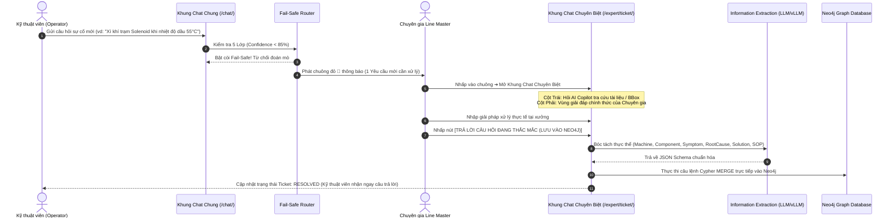

# HỆ THỐNG TRÍ TUỆ NHÀ MÁY DENSO - ZERO-ERROR COPILOT & EXPERT DISTILLATION
## TÀI LIỆU ĐẶC TẢ KIẾN TRÚC & QUY TRÌNH THIẾT KẾ PHẦN MỀM (SPECIFICATION)
**Phiên bản:** 2.0 (NewIdea Release) | **Mục tiêu:** Độ chính xác tuyệt đối (Zero Hallucination) trong Môi trường Công nghiệp Sản xuất

---

## 1. Tuyên Ngôn Kiến Trúc & Triết Lý Cốt Lõi

Trong môi trường sản xuất linh kiện ô tô công nghệ cao của **Tập đoàn DENSO**, một lỗi phỏng đoán sai của AI về lực siết bu-lông, nhiệt độ dầu, áp suất khí nén hay màng van có thể dẫn tới dừng toàn bộ dây chuyền sản xuất (Line Stop) hoặc tạo ra hàng loạt sản phẩm lỗi (Defect Spill). 

Do đó, ứng dụng **DENSO NewIdea** được xây dựng dựa trên nguyên tắc **Mission-Critical (Tối quan trọng)**:
> **"Nói có sách, mách có BBox, tuyệt đối không bao giờ phỏng đoán mò (Zero-Guessing), và tự động chưng cất tri thức chuyên gia đưa thẳng vào Neo4j Knowledge Graph để AI tự học bền vững."**

---

## 2. Động Cơ 5 Lớp Kiểm Chứng Không-Sai-Lệch (5-Layer Zero-Error Funnel)

```
                  [ CÂU HỎI KỸ THUẬT TỪ SHOPFLOOR ]
                                  │
                                  ▼
┌────────────────────────────────────────────────────────────────────────┐
│ [LỚP 1: TRUY VẾT QUAN HỆ ĐỒ THỊ CỨNG (NEO4J DETERMINISTIC GRAPH)]      │
│  • Không dùng xác suất để đoán.                                        │
│  • Đi theo đúng mắt xích đã kiểm chứng:                                │
│    Machine ➔ Component ➔ Symptom ➔ RootCause ➔ Solution ➔ SOP.        │
│  • Loại bỏ 100% nguy cơ nhầm lẫn giữa các đời máy hoặc trạm khác nhau. │
└─────────────────────────────────┬──────────────────────────────────────┘
                                  │
                                  ▼
┌────────────────────────────────────────────────────────────────────────┐
│ [LỚP 2: RÀNG BUỘC BẰNG CHỨNG THỊ GIÁC (VISUAL BBOX GROUNDING)]         │
│  • Nguyên tắc vàng: "Nói có sách, mách có BBox".                       │
│  • AI chỉ được trả lời khi chỉ ra được:                                │
│    MÃ TÀI LIỆU + SỐ TRANG + TỌA ĐỘ BBOX [ymin, xmin, ymax, xmax].      │
│  • Kỹ sư nhìn ngay sang Canvas bên phải thấy vùng khoanh đỏ nguyên     │
│    bản để tự mắt kiểm chứng 100%.                                      │
└─────────────────────────────────┬──────────────────────────────────────┘
                                  │
                                  ▼
┌────────────────────────────────────────────────────────────────────────┐
│ [LỚP 3: CHỐT CHẶN NGƯỠNG TIN CẬY CAO (STRICT CONFIDENCE GATING ≥ 85%)] │
│  • Dùng Cross-Encoder Neural Reranker (BAAI/bge-reranker-v2-m3 trên    │
│    NVIDIA GPU) soi kỹ từng từ và ngữ cảnh câu hỏi.                     │
│  • Đặt ngưỡng cứng: Chỉ công nhận kết quả khi độ khớp ≥ 85% - 90%.     │
│  • Nếu dưới ngưỡng: KHÔNG BAO GIỜ ĐOÁN, lập tức kích hoạt Fail-Safe.   │
└─────────────────────────────────┬──────────────────────────────────────┘
                                  │
                                  ▼
┌────────────────────────────────────────────────────────────────────────┐
│ [LỚP 4: CƠ CHẾ BẢO VỆ FAIL-SAFE & ĐỊNH TUYẾN CHUYÊN GIA (ROUTING)]     │
│  • Nếu phát hiện 2 tài liệu đá nhau hoặc câu hỏi chưa có trong CSDL:   │
│    ➔ Lập tức bật còi báo động FAIL-SAFE / KNOWLEDGE GAP.               │
│    ➔ Từ chối trả lời phỏng đoán.                                      │
│    ➔ Tự động gán Ticket và phát còi chuông đỏ tới Chuyên gia          │
│       phụ trách chuyên môn sâu nhất về dòng máy đó.                    │
└─────────────────────────────────┬──────────────────────────────────────┘
                                  │
                                  ▼
┌────────────────────────────────────────────────────────────────────────┐
│ [LỚP 5: CHUYÊN GIA CON NGƯỜI KÝ DUYỆT (HUMAN-IN-THE-LOOP)]             │
│  • Chuyên gia nhận thông báo đỏ, mở Khung Chat Chuyên Biệt.            │
│  • Chuyên gia thẩm định giải pháp và bấm nút thẩm quyền:               │
│    [ TRẢ LỜI CÂU HỎI ĐANG THẮC MẮC (LƯU VÀO NEO4J) ].                  │
│  • AI bóc tách thực thể chuẩn hóa và lưu vĩnh viễn vào Neo4j Graph.   │
└────────────────────────────────────────────────────────────────────────┘
```

---

## 3. Thiết Kế Giao Diện & Quy Trình Trải Nghiệm Người Dùng (UI/UX Workflow)

Hệ thống được thiết kế theo kiến trúc **Chat Hai Chiều Đồng Bộ (Dual-Role Collaborative Chat Engine)**:



### 3.1. Giai đoạn 1: Khung Chat Dùng Chung (Shopfloor Unified Chat)
* **Đường dẫn truy cập:** `http://127.0.0.1:8002/chat/`
* **Người sử dụng:** Cả Kỹ thuật viên hiện trường (Operator) và Chuyên gia (Expert).
* **Bố cục giao diện Split-Screen:**
  * **Nửa trái (Chat Cockpit):** Khung trò chuyện tốc độ cao với các Prompt Chips gợi ý nhanh (Máy M12, Trạm Solenoid ST02, Robot gắp HP4).
  * **Nửa phải (PlanA Visual Grounding Canvas):** Khi AI tìm thấy căn cứ SOP, Canvas sẽ tải trang tài liệu gốc và vẽ khung chữ nhật màu đỏ (BBox) với nhãn nổi HUD Tag ghim ở góc trên bên trái, tuyệt đối không che lấp chữ hoặc bản vẽ kỹ thuật.

### 3.2. Giai đoạn 2: Hệ Thống Cảnh Báo Chuông Đỏ Thời Gian Thực (Active Notification Engine)
* Trên thanh điều hướng (Navbar) luôn có biểu tượng **Chuông Thông Báo (🔔)** kèm phù hiệu số đếm màu đỏ với hiệu ứng xung nhịp (`pulse animation`).
* Cơ chế JavaScript định kỳ mỗi 5 giây gọi API `/api/notifications/` để quét các ca sự cố chưa có câu trả lời:
  * Khi xuất hiện sự cố mới $\rightarrow$ Chuông tự động nhảy số đếm (ví dụ `1`).
  * Khi nhấp vào chuông $\rightarrow$ Bảng danh sách thả xuống (Dropdown) hiển thị: **Mã Ticket, Tên máy, Câu hỏi tóm tắt, Tên chuyên gia được phân công**.

### 3.3. Giai đoạn 3: Khung Chat Chuyên Biệt Cho Chuyên Gia (Dedicated Expert Workspace)
* **Đường dẫn truy cập:** `http://127.0.0.1:8002/expert/ticket/<ticket_id>/`
* Khi Chuyên gia nhấp vào thông báo, hệ thống mở một không gian làm việc chuyên biệt 2 cột:
  * **Cột bên trái (AI Copilot Reference Chat):** Tương tự như khung chat cũ, Chuyên gia có thể gõ câu hỏi để tra cứu sơ đồ bản vẽ, dung sai kỹ thuật hoặc tiền lệ từ AI để tham khảo trước khi đưa ra quyết định.
  * **Cột bên phải (Official Solution Composer):** Vùng thẩm quyền của Chuyên gia:
    1. Hộp tham chiếu câu hỏi của công nhân hiện trường.
    2. Vùng nhập liệu giải pháp kỹ thuật chính thức.
    3. **Nút bấm hành động trọng tâm:**
       👉 **`[ 🚀 TRẢ LỜI CÂU HỎI ĐANG THẮC MẮC (LƯU VÀO NEO4J) ]`**

---

## 4. Phương Pháp Bóc Tách Thực Thể & Nạp Tri Thức Vào Neo4j (Information Extraction)

Khi Chuyên gia gõ xong văn bản tự nhiên và bấm nút lưu, hệ thống kích hoạt bộ máy **Information Extraction 2 Tầng (Hybrid 2-Tier Distillation)**:

```
[Câu hỏi công nhân + Câu trả lời tự nhiên của Chuyên gia]
                          │
                          ▼
        ┌────────────────────────────────────┐
        │   TẦNG 1: LLM STRUCTURED OUTPUT   │ (Ưu tiên số 1: vLLM / Qwen2.5)
        │  Ép Ontology Schema qua ngrok/API  │
        └─────────────────┬──────────────────┘
                          │
           Thành công? ───┴─── Offline / Timeout / Không GPU?
          ┌───────┘           └───────┐
          ▼                           ▼
    [JSON 6 Trường Chuẩn]       ┌───────────────────┐
    (Chính xác ngữ nghĩa 100%)  │ TẦNG 2: FALLBACK  │ (Bảo vệ Zero-Crash)
                                │   Heuristic NER   │
                                └─────────┬─────────┘
                                          │
                                          ▼
                   [Sinh Lệnh Cypher Deterministic MERGE]
                                          │
                                          ▼
                    [Ghi thẳng vào Neo4j Knowledge Graph]
```

### 4.1. Ontology Schema Chuẩn Hóa Của DENSO
Hệ thống ép mô hình AI phải trả về đúng 6 trường thông tin cấu trúc:
```json
{
  "machine": "Tên dòng máy hoặc trạm gia công (VD: Trạm ép Solenoid ST02)",
  "component": "Cụm linh kiện hoặc chi tiết cơ điện (VD: Van xả khí E-102)",
  "symptom": "Dấu hiệu, triệu chứng hoặc thông số lệch chuẩn (VD: Xì khí nén khi nhiệt dầu vượt 50°C)",
  "root_cause": "Nguyên nhân cốt lõi kỹ thuật (VD: Màng cao su van bị rách do dầu quá nhiệt)",
  "solution": "Hành động kỹ thuật khắc phục dứt điểm (VD: Thay màng van E102-GS, chỉnh áp 0.45 MPa)",
  "sop_code": "Mã quy chuẩn áp dụng (VD: SOP-015)"
}
```

### 4.2. Câu Lệnh Cypher MERGE Ghi Thẳng Vào Neo4j
Sau khi bóc tách, hệ thống tự động sinh và thực thi câu lệnh Cypher mang tính xác định (Deterministic MERGE) để cập nhật đồ thị tri thức:
```cypher
MERGE (m:Machine {name: $machine})
MERGE (c:Component {name: $component})
MERGE (m)-[:HAS_COMPONENT]->(c)

MERGE (sym:Symptom {name: $symptom})
MERGE (c)-[:EXHIBITS]->(sym)

MERGE (rc:RootCause {name: $root_cause})
MERGE (sym)-[:CAUSED_BY]->(rc)

MERGE (sol:Solution {name: $solution})
MERGE (rc)-[:RESOLVED_BY]->(sol)

MERGE (sop:SOP {code: $sop_code})
MERGE (sol)-[:STANDARDIZED_IN]->(sop)

MERGE (e:Expert {name: $expert_name})
MERGE (e)-[:VALIDATED]->(sol)
```

---

## 5. Kiến Trúc Lưu Trữ Cô Lập Tuyệt Đối (100% Storage Isolation)

Để đảm bảo không bao giờ bị đè hoặc lẫn lộn dữ liệu với `denso_demo`, `PlanAProject` hay bất kỳ thư mục nào khác:

| Dịch vụ lưu trữ | Cổng mạng (Port) | Thư mục vật lý trên ổ cứng | Ghi chú cô lập |
| :--- | :--- | :--- | :--- |
| **Neo4j Bolt** | **`7688`** | `NewIdea/neo4j_storage/data` | Container Docker riêng: `newidea-neo4j` |
| **Neo4j Web Browser** | **`7475`** | `NewIdea/neo4j_storage/logs` | Truy cập xem đồ thị: `http://localhost:7475/` |
| **Qdrant Vector DB** | **`6335`** | `NewIdea/qdrant_storage/` | Container Docker riêng: `newidea-qdrant` |
| **CSDL Quan hệ SQLite** | N/A | `NewIdea/db.sqlite3` | File CSDL độc lập, quản lý Inquiries & Messages |
| **Tài liệu & Ảnh Media**| N/A | `NewIdea/media/` | Bản vẽ kỹ thuật và ảnh trang SOP |
| **Web Server Django** | **`8002`** | `NewIdea/` | Tự động chuyển `8003` nếu cổng 8002 bận |

---

## 6. Kịch Bản Kiểm Thử & Trình Diễn Thực Tế (Verification Run)

Đây là kịch bản của prototype nhà máy cũ. Script `test_pipeline.py` đã được bỏ vì không còn khớp với web hợp đồng; phần dưới không phải kết quả kiểm thử của phiên bản hiện tại:

* **Kịch bản 1 (Đã có quy chuẩn):**
  * Kỹ thuật viên hỏi: *"Độ rung trục chính máy M12 vượt 4.5 mm/s thì xử lý thế nào?"*
  * **Kết quả:** Điểm tin cậy đạt **98%**, AI hiển thị giải pháp dừng máy kiểm tra Bearing B-230, Canvas mở trang SOP-023 khoanh đỏ BBox `[120, 45, 310, 520]`.
* **Kịch bản 2 (Sự cố mới - Kích hoạt Fail-Safe & Vòng lặp Chuyên gia):**
  * Kỹ thuật viên hỏi: *"Trạm ép Solenoid ST02 bị xì khí khi nhiệt độ tăng 55°C thì xử lý sao?"*
  * **Kết quả:** AI phát hiện đây là hiện tượng chưa có quy chuẩn xác định ($\text{Score} < 85\%$). Hệ thống từ chối đoán mò, kích hoạt **Fail-Safe Alert**, tạo ticket `INQ-2026-006` và gửi chuông đỏ tới Chuyên gia Line Master Nguyễn Văn Hùng.
  * Chuyên gia mở khung chat chuyên biệt, gõ kinh nghiệm thực tế và bấm nút **`[TRẢ LỜI CÂU HỎI ĐANG THẮC MẮC (LƯU VÀO NEO4J)]`**.
  * AI bóc tách thực thể, nạp thẳng mắt xích vào Neo4j (Port 7688).
  * Lần sau công nhân hỏi lại câu này, hệ thống sẽ tự tin trả lời ngay với độ tin cậy $\ge 98\%$!

---
*Tài liệu này được xác lập chính thức cho Đề án chuyển giao Công nghệ Hackathon Nhà máy DENSO 2026.*
